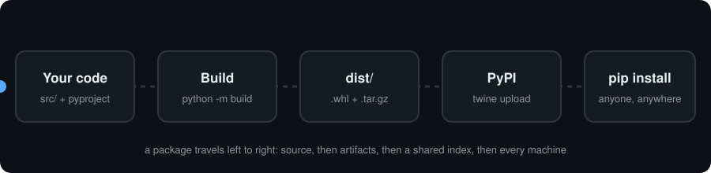
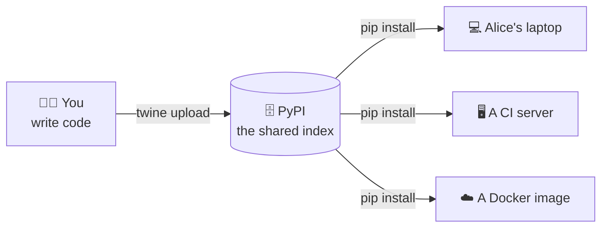
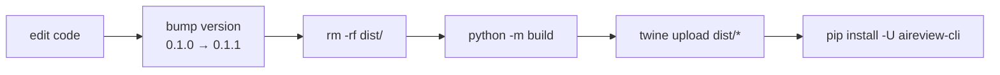

<div align="center">

# 📦 From a folder of Python to `pip install`

**What a package is, how to make one, and how to publish it to PyPI**
*using `aireview-cli` as the worked example*



</div>

---

## 🪜 The journey: how a Python file matures

Nobody starts with a package. Code **grows up** through five stages, and each stage exists because the previous one started to hurt.

```mermaid
flowchart LR
    A["1 · Snippet<br/>a few lines"] --> B["2 · Script<br/>runs top to bottom"]
    B --> C["3 · Module<br/>importable .py file"]
    C --> D["4 · Package<br/>folder + &#95;&#95;init&#95;&#95;.py"]
    D --> E["5 · Distribution<br/>wheel + sdist"]
    E --> F[("PyPI<br/>pip install")]
```



| Stage | What it is | What hurts, so you move on | In `aireview` |
|---|---|---|---|
| **1. Snippet** | A few lines pasted in a REPL, notebook or chat. No structure. | You can't re-run it or share it cleanly. | `ollama.chat(model=..., messages=...)` |
| **2. Script** | A `.py` file you run with `python file.py`. Does one job, top to bottom. | Everything is tangled, and importing it *runs* it. | one big `review.py` |
| **3. Module** | A `.py` file whose functions are meant to be **imported**, with runnable code guarded by `if __name__ == "__main__":`. | One file gets too big; related code wants its own home. | `llm.py`, `ui.py` |
| **4. Package** | A **folder** of modules with an `__init__.py`, imported as one unit (`import aireview`). Can expose a command via an entry point. | It only works on *your* machine, from *your* folder. | `src/aireview/` |
| **5. Distribution** | The package + metadata (`pyproject.toml`) built into an installable file: a **wheel** (`.whl`) and **sdist** (`.tar.gz`). | Nobody else can get it with one command. | `aireview_cli-0.1.0-py3-none-any.whl` |
| **→ PyPI** | You **upload** the distribution to the public index. | (no more pain) | `pip install aireview-cli` |

The key shifts:

- **Script → module**: stop running on import. Wrap the entry code in `if __name__ == "__main__":` so other files can `import` your functions safely.
- **Module → package**: group files into a folder; `__init__.py` tells Python "this folder is importable".
- **Package → distribution**: add `pyproject.toml` (name, version, dependencies, command). A *build tool* turns it into a wheel, which is just a zip `pip` knows how to unpack.
- **Distribution → PyPI**: upload with `twine`, and anyone can install it.

The rest of this guide walks stages 4 → PyPI using this project.

---

## Contents
0. [The journey: snippet → PyPI](#-the-journey-how-a-python-file-matures)
1. [What is PyPI?](#1-what-is-pypi)
2. [What is a package?](#2-what-is-a-package)
3. [Anatomy of a package](#3-anatomy-of-a-package)
4. [Making one: `pyproject.toml` line by line](#4-making-one-pyprojecttoml-line-by-line)
5. [Building it](#5-building-it)
6. [Publishing to PyPI](#6-publishing-to-pypi)
7. [Releasing updates](#7-releasing-updates)
8. [Gotchas](#8-gotchas)
9. [Cheat sheet](#9-cheat-sheet)

---

## 1. What is PyPI?

**PyPI** (the *Python Package Index*, at [pypi.org](https://pypi.org)) is a **distribution system**: one shared public place where Python code is uploaded once and downloaded by anyone.

| Without PyPI | With PyPI |
|---|---|
| "Clone my repo, set up a venv, run these 5 commands…" | `pip install aireview-cli` |
| Everyone needs your source and your setup steps | Everyone needs one command |
| No versions, no updates | Versions, `pip install -U`, pinned in `requirements.txt` |

Think of it like an **app store for Python libraries and tools**:



Two things to keep apart:

- **PyPI** is the *store* (a website + file hosting).
- **pip** is the *client* that downloads from the store and installs.

Every `pip install requests` or `pip install rich` you have ever run came from PyPI. Our project itself depends on `ollama`, `pydantic`, `rich` and `typer`; `pip` fetches those from PyPI automatically when someone installs ours.

### Who maintains it?

- **Owned and run by the [Python Software Foundation (PSF)](https://www.python.org/psf/)**, the non-profit that also stewards the Python language itself.
- **Day to day**: a small team of PSF staff (infrastructure and security engineers) plus volunteer admins and moderators.
- **The software** that powers pypi.org is an open-source project called [**Warehouse**](https://github.com/pypi/warehouse), developed under the **[PyPA](https://www.pypa.io)** (Python Packaging Authority), the group that also maintains `pip`, `build`, `twine`, `setuptools` and the packaging standards (PEPs).
- **Paid for** by donations and sponsors (cloud, CDN and security companies donate hosting and bandwidth). **It is free for you**, which is why abuse prevention (2FA, malware scanning, name rules) matters.
- **Not reviewed**: PyPI does not vet your code. Anyone can publish, so users must trust the *author*, not PyPI.

### What do *you* need to contribute a package?

| You provide | Why |
|---|---|
| A **PyPI account with 2FA** (required) | Identity and security |
| A **unique project name** | Names are first-come, first-served |
| **`pyproject.toml`** with name, version, description, Python version, dependencies | PyPI and `pip` read this |
| **Importable code** (a package, typically `src/<name>/`) | The thing being shipped |
| A **README** | Becomes your project page |
| A **license** (e.g. MIT) | Tells people if they may use it |
| A **built distribution** (`.whl` + `.tar.gz` in `dist/`) | What actually gets uploaded |
| An **API token** (or Trusted Publishing from GitHub Actions) | Authenticates the upload; no passwords |
| A **new version number every release** | PyPI never lets you overwrite or reuse a version |

Section 6 below does each of these in order.

> **TestPyPI** ([test.pypi.org](https://test.pypi.org)) is a separate sandbox copy of PyPI. Uploads there are throwaway, so you can rehearse a release safely.

---

## 2. What is a package?

The word is used loosely. There are three different things:

| Term | What it is | Example |
|---|---|---|
| **Module** | A single `.py` file you can `import` | `llm.py` |
| **Package** | A folder of modules with an `__init__.py` | `src/aireview/` |
| **Distribution** | The *installable bundle* uploaded to PyPI (what people usually mean) | `aireview-cli-0.1.0-py3-none-any.whl` |

```python
import aireview            # the package   (import name)
```
```bash
pip install aireview-cli   # the distribution   (install name)
```

The **install name and import name can differ**. Here `aireview` was already taken on PyPI, so the distribution is `aireview-cli` while the code is still `import aireview` and the command is still `aireview`. (`pip install beautifulsoup4` → `import bs4` is the famous example.)

A distribution is just **your code + a description of it** (name, version, dependencies, which command to create) in a standard format that `pip` understands.

---

## 3. Anatomy of a package


The `src/` layout (code in `src/aireview/`, not in the project root) is deliberate: it stops you from accidentally testing the folder on your disk instead of the *installed* package.

---

## 4. Making one: `pyproject.toml` line by line

`pyproject.toml` is the **single file** that turns a folder into something installable.

```toml
[build-system]                     # HOW to build it
requires = ["hatchling"]           #   the build tool pip downloads for you
build-backend = "hatchling.build"

[project]                          # WHAT it is
name = "aireview-cli"              #   the name on PyPI (must be unique)
version = "0.1.0"                  #   bump on every release
description = "Local AI git diff reviewer ..."   # one-line summary on PyPI
readme = "README.md"               #   shown as the project page
license = "MIT"
requires-python = ">=3.10"
dependencies = [                   #   pip installs these automatically
    "ollama>=0.4", "pydantic>=2.5", "rich>=13.7", "typer>=0.12",
]

[project.scripts]                  # THE MAGIC for CLI tools
aireview = "aireview.cli:app"      #   command name = module path : function

[tool.hatch.build.targets.wheel]
packages = ["src/aireview"]        # which folder to ship
```

### The one line that makes it a command

```toml
aireview = "aireview.cli:app"
```

Read it as: *"create a terminal command called `aireview` that imports `app` from `aireview/cli.py` and runs it."* On install, `pip` writes a small launcher script onto your `PATH`. That is the whole trick behind `git`-style Python tools like `black`, `pytest` and `ruff`.

### Optional but useful metadata

`classifiers`, `keywords` and `[project.urls]` do not change how the code runs. They fill in the sidebar on the PyPI page and make the project searchable.

---

## 5. Building it

Building turns your folder into the files PyPI stores.

```bash
pip install build twine
python -m build
```

```
dist/
├── aireview_cli-0.1.0-py3-none-any.whl     ← wheel: pre-built, installs instantly
└── aireview_cli-0.1.0.tar.gz               ← sdist: source archive, fallback
```

| File | Meaning |
|---|---|
| **wheel** (`.whl`) | Ready-to-unpack zip. `pip` prefers it because nothing has to be compiled. `py3-none-any` = any Python 3, any OS. |
| **sdist** (`.tar.gz`) | Your source plus metadata. Used when no wheel fits. |

Check them before uploading:

```bash
twine check dist/*        # validates metadata and README rendering
```

Want to see what is inside? A wheel is a plain zip:

```bash
unzip -l dist/*.whl
```

---

## 6. Publishing to PyPI

### Step 1: Check that the name is free
Open `https://pypi.org/project/<your-name>/`. A 404 means it is available.

### Step 2: Create accounts and tokens
1. Register at [pypi.org](https://pypi.org/account/register/) (and [test.pypi.org](https://test.pypi.org/account/register/) for rehearsals) and turn on 2FA.
2. Go to *Account settings → API tokens → Add token*. Copy it once; PyPI never shows it again.
3. Never commit the token. Use it as the password with username `__token__`.

### Step 3: Rehearse on TestPyPI
```bash
twine upload --repository testpypi dist/*
# username: __token__    password: pypi-AgEI...

python3 -m venv /tmp/try && source /tmp/try/bin/activate
pip install --index-url https://test.pypi.org/simple/ \
            --extra-index-url https://pypi.org/simple/ aireview-cli
aireview --help
```
(`--extra-index-url` lets the dependencies come from the real PyPI.)

### Step 4: Upload for real
```bash
twine upload dist/*
```
A minute later, anyone in the world can run:

```bash
pip install aireview-cli
```

Your page is live at `https://pypi.org/project/aireview-cli/`.

---

## 7. Releasing updates



Versions follow **MAJOR.MINOR.PATCH** ([semver](https://semver.org)):

| Bump | When | Example |
|---|---|---|
| PATCH | bug fix | `0.1.0 → 0.1.1` |
| MINOR | new feature, nothing breaks | `0.1.1 → 0.2.0` |
| MAJOR | breaking change | `0.2.0 → 1.0.0` |

---

## 8. Gotchas

- **Versions are permanent.** You cannot re-upload `0.1.0` with changes, even after deleting it. Bump the number instead. This is why TestPyPI rehearsals matter.
- **Names are first come, first served.** Check before you build a brand around one.
- **Clear `dist/` before each build**, or `twine` will try to re-upload old files.
- **Your README is your landing page.** Lead with what the tool does and a `pip install` line, not a tutorial.
- **Tokens are secrets.** If one leaks, revoke it on PyPI right away.
- **External requirements are not installed by pip.** `aireview-cli` also needs Ollama and a pulled model, so the README says so up front.

---

## 9. Cheat sheet

```bash
# one-time
pip install build twine

# every release
rm -rf dist/
python -m build              # → dist/*.whl + dist/*.tar.gz
twine check dist/*           # sanity check
twine upload --repository testpypi dist/*   # rehearsal
twine upload dist/*          # the real thing

# users
pip install aireview-cli
aireview
```

<div align="center">

**folder → `pyproject.toml` → `python -m build` → `twine upload` → `pip install`**

</div>
